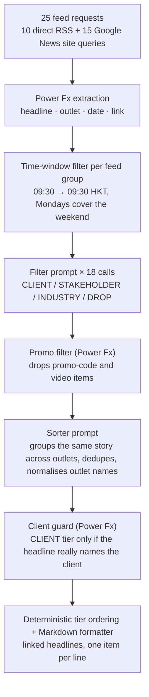

# Hong Kong media-monitoring agent

An AI agent that builds a daily news briefing for a Hong Kong digital bank. It collects the day's articles from 26 Hong Kong and international outlets, decides which ones matter to the client, removes duplicates of the same story, and returns a ranked, link-ready list for the morning report.

Built in **Microsoft Copilot Studio**, with **Power Fx** for the deterministic steps and **AI Builder prompts** for classification and sorting. Client names, shareholders and model IDs are replaced with placeholders in this public version.

**Status:** pilot build (September 2026).

## How it works

**Why the split between Power Fx and LLM calls.** Anything that has one correct answer runs in Power Fx: parsing feeds, date windows, ordering and the client-name check. The models only do judgement calls, such as "is this story about Hong Kong financial services?". This makes the output reproducible and cheaper, and it removed a whole class of silent errors (see below).

## Classification rules

The [filter prompt](prompts/NewsFilterPrompt.md) applies a **Hong Kong test** first: a story qualifies only if it concerns a Hong Kong institution, market or policy. Then the first matching tier wins:

| Tier | What qualifies |
|---|---|
| CLIENT | Names the client anywhere, including rate tables and product round-ups |
| STAKEHOLDER | Names one of the client's shareholders (any topic) |
| INDUSTRY | Hong Kong digital-bank competitors, regulators (HKMA, SFC, IA, HKEX), macro data, retail banks, insurance, digital-asset policy |
| DROP | Everything else, including opinion columns, advertorials, routine market reports and masthead-only lines |

Headlines arrive in both English and Traditional Chinese, so every rule lists names in both languages.

## Problems I found and fixed

| Problem | Fix |
|---|---|
| The LLM parser silently dropped **48%** of items (graphic items were thrown away) | First, graphic items emit a `SKIPPED` placeholder. Later the LLM parser was **replaced entirely with Power Fx extraction**: 1,290 / 1,290 items extracted, with no parser model calls |
| Large feeds (Ming Pao) hit the model's ~25k output ceiling, cutting the list from ~95 lines to 47 | Split across two calls, then made unnecessary by the Power Fx parser |
| Reuters was missing from results | The cause was the Google News **locale**, not the outlet: switched SCMP, FT, WSJ and Reuters to English-locale queries |
| Too many outlets in one Google query crowded each other out | Split FT and WSJ into their own query groups |
| A dead Oriental Daily feed | Moved to a Google News site query |
| i-Cable feed only reached a few hours back | Switched to WordPress category feeds (6-day reach, real dates) |
| A model mistake could put an unrelated story in the top (CLIENT) section | Power Fx guard moves any CLIENT item that doesn't actually name the client down a tier |
| Raw Chinese outlet names and same-outlet repeats in the output | Sorter prompt normalises outlet names and dedupes same-outlet items |

## Coverage

26 of 27 requested outlets. [`tools/probe_feeds_v2.py`](tools/probe_feeds_v2.py) checked each outlet for a usable feed: it tries 40+ common feed paths, reads `<link rel=alternate>` tags, sitemaps and robots.txt, and falls back to a Google News site query. Results are in [`tools/feed_probe_v2.csv`](tools/feed_probe_v2.csv).

Known gaps:
- **Bloomberg:** no usable feed, and its terms prohibit automated access.
- **AASTOCKS, Infocast:** not indexed by Google News, so only partial coverage is possible.
- **HK01:** removed because the platform's content moderation blocked its feed.

## Repository layout

| Path | Contents |
|---|---|
| `copilot-studio-agent/topics/Main_NoDebug.mcs.yml` | The full pipeline (≈4,900 lines of Copilot Studio YAML and Power Fx) |
| `copilot-studio-agent/actions/` | The sorter prompt action |
| `prompts/` | Filter and sorter prompts, readable |
| `tools/` | Feed-discovery script and its results |
